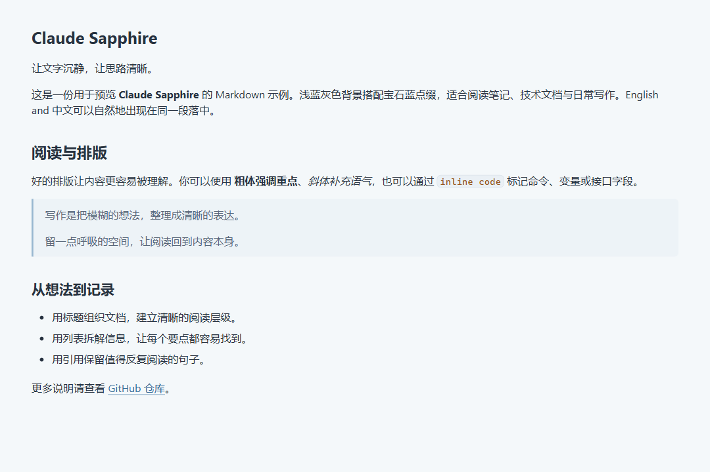
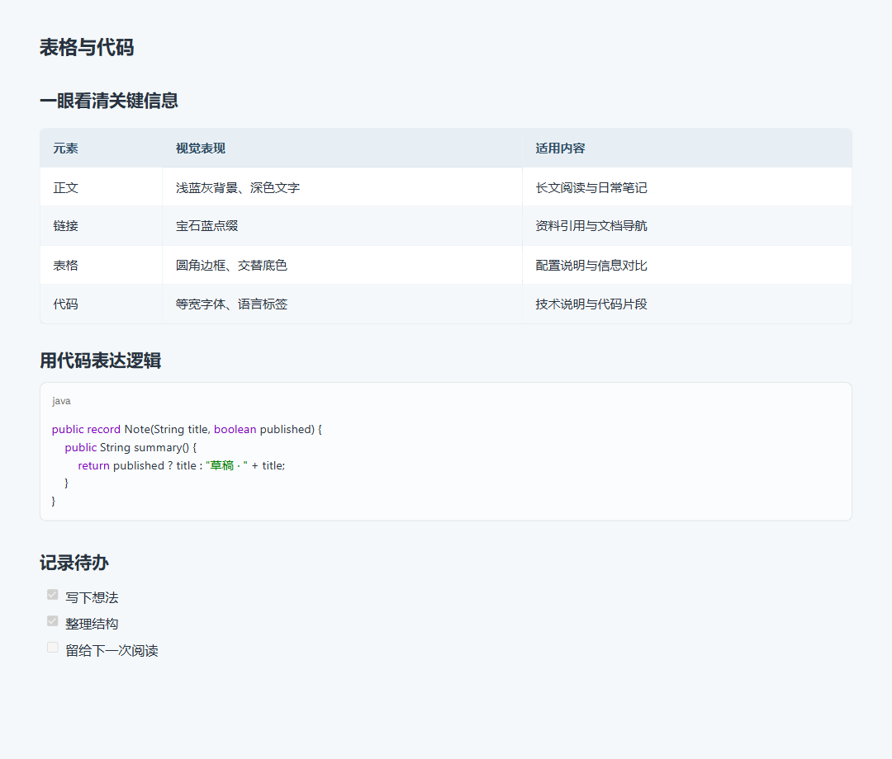

# Claude Sapphire

**EN** | [中文](README.zh-CN.md)

A **light theme for Typora**, built on the Claude theme. Soft blue-gray surfaces, sapphire accents, and clear text hierarchy create a calm reading experience for notes and technical documentation.

## Preview

### Typography and Prose



### Tables and Code



> These images were rendered in Chromium using the project's actual CSS and Typora's base styles; they do not show the editor interface. Fonts, Typora versions, and settings may affect the appearance on your system. Open the [sample Markdown document (Chinese)](examples/主题示例.md) in Typora to preview the theme yourself.

## Features

- **Soft blue-gray palette**: consistent colors across the document, sidebar, and file menu, with sapphire accents for links and navigation.
- **Readable typography**: 16px body text, 1.5 line height, six heading levels, and font fallbacks for mixed Chinese and English text.
- **Refined tables**: rounded borders, alternating row colors, hover feedback, and horizontal scrolling for wide tables.
- **Code styling**: monospace fonts, code block language labels, syntax colors, and inline code styling.
- **Alerts and diagrams**: styles for NOTE, TIP, IMPORTANT, WARNING, and CAUTION alerts, plus Mermaid flowcharts.
- **Standalone theme file**: base styles are included in `claude-sapphire.css`; no separate Claude theme installation is required.
- **Print styles**: repeating table headers and table row pagination rules; actual page breaks depend on document content and export settings.

## Installation

1. Select **Code → Download ZIP** on this repository and extract the archive, or clone it:

   ```bash
   git clone https://github.com/emptypty01/claude-sapphire.git
   ```

2. In Typora, open **Preferences → Appearance → Open Theme Folder**.
3. Copy `claude-sapphire.css` and the entire `claude_fonts` folder into the theme folder, preserving this layout:

   ```text
   themes/
   ├── claude-sapphire.css
   └── claude_fonts/
       ├── AnthropicSansWebText.ttf
       ├── AnthropicSerifWebText.ttf
       ├── AnthropicMonoVariable.ttf
       └── NotoSerifSC-VariableFont_wght.ttf
   ```

4. Restart Typora and select **Claude Sapphire** from the **Themes** menu. The displayed name may vary slightly by version.
5. Open [examples/主题示例.md](examples/主题示例.md) to preview prose, tables, code, alerts, and Mermaid diagrams.

To update, replace the theme CSS and font folder, then restart Typora. If you have edited the theme file, preserve your customizations first.

For more details, see the [official Typora theme guide](https://support.typora.io/About-Themes/).

## Fonts

The theme retains the base Claude font declarations and uses the following font stacks for body text and code:

| Usage | Font priority |
| --- | --- |
| Body text and headings | Bookerly → Inter → Segoe UI → 霞鹜文楷 GB → LXGW WenKai → Microsoft YaHei → sans-serif |
| Code | JetBrains Mono → Cascadia Code → Consolas → monospace |
| Base interface | Anthropic Sans Web Text → system sans-serif fonts |

Optional fonts such as Bookerly, Inter, LXGW WenKai, and JetBrains Mono are not bundled; install them separately if desired. Font fallback happens per character, so Chinese and English text may use different fonts.

The fonts in `claude_fonts/` support the base font declarations; copying the folder does not make them the default body fonts. The CSS also retains an `UnifrakturMaguntia` declaration, but its font file is not included in this repository. Text referencing it will fall back to the remaining fonts in its stack.

## Customization

Following [Typora's custom CSS guide](https://support.typora.io/Add-Custom-CSS/), create or edit `claude-sapphire.user.css` in the theme folder to keep personal settings across theme updates. This example adjusts fonts, the blue accent, and the reading width:

```css
:root {
    --font-serif: "LXGW WenKai", "Microsoft YaHei", sans-serif;
    --font-mono: "JetBrains Mono", Consolas, monospace;
    --topaz-accent: #326a96;
}

@media screen {
    #write {
        max-width: 1080px;
    }
}
```

The default maximum reading width is `1280px`, with reduced side padding in narrow windows. `--topaz-accent` controls styles that reference this variable; some components use their own colors.

## FAQ

**The theme does not appear in the menu.**  
Make sure `claude-sapphire.css` itself is directly inside Typora's theme folder, rather than inside an extra repository folder, then restart Typora.

**Fonts look different from the previews.**  
Check your installed fonts and the fallback order above. Make sure `claude_fonts/` sits alongside the CSS file. System scaling and Typora's zoom level also affect the appearance.

**Alerts or diagrams are not rendered.**  
These features depend on Typora's support for the corresponding Markdown extensions. Check your Typora version and Markdown settings. The theme provides styling; it does not include a Markdown or Mermaid renderer.

**Is there a dark version?**  
Only a light theme is currently available.

## Credits and License

The CSS integrates styles from the Claude theme. Claude is an Anthropic product name; this is an independent Typora theme project.

See [LICENSE](LICENSE) for the repository's license. Third-party fonts and inherited theme resources remain subject to their original licenses; the repository license does not replace those terms.

For display issues, please include your Typora version, operating system, and a reproducible Markdown snippet in an [issue](https://github.com/emptypty01/claude-sapphire/issues).
