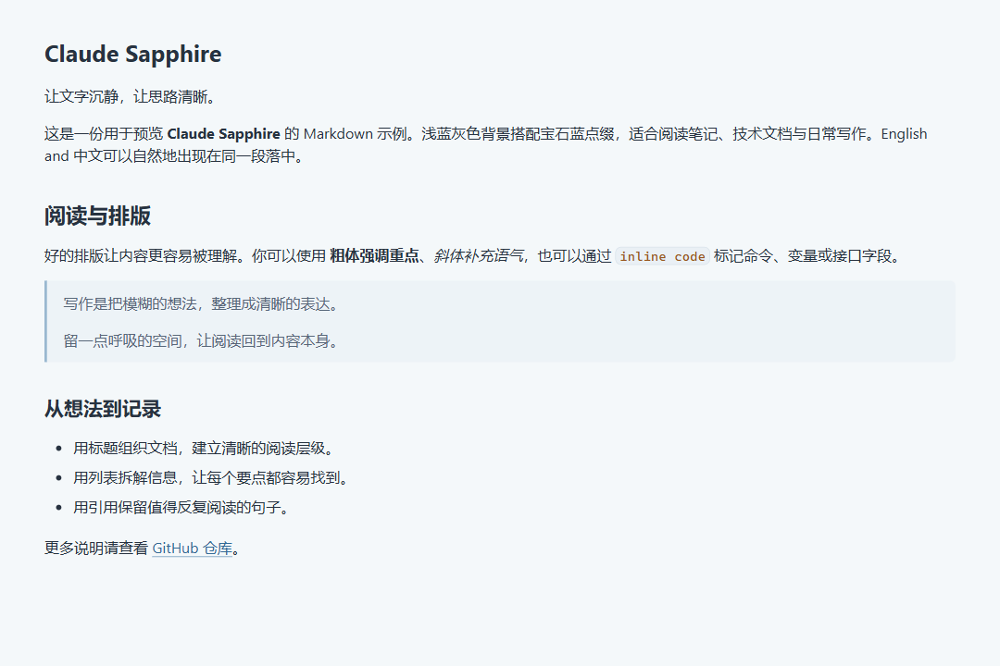
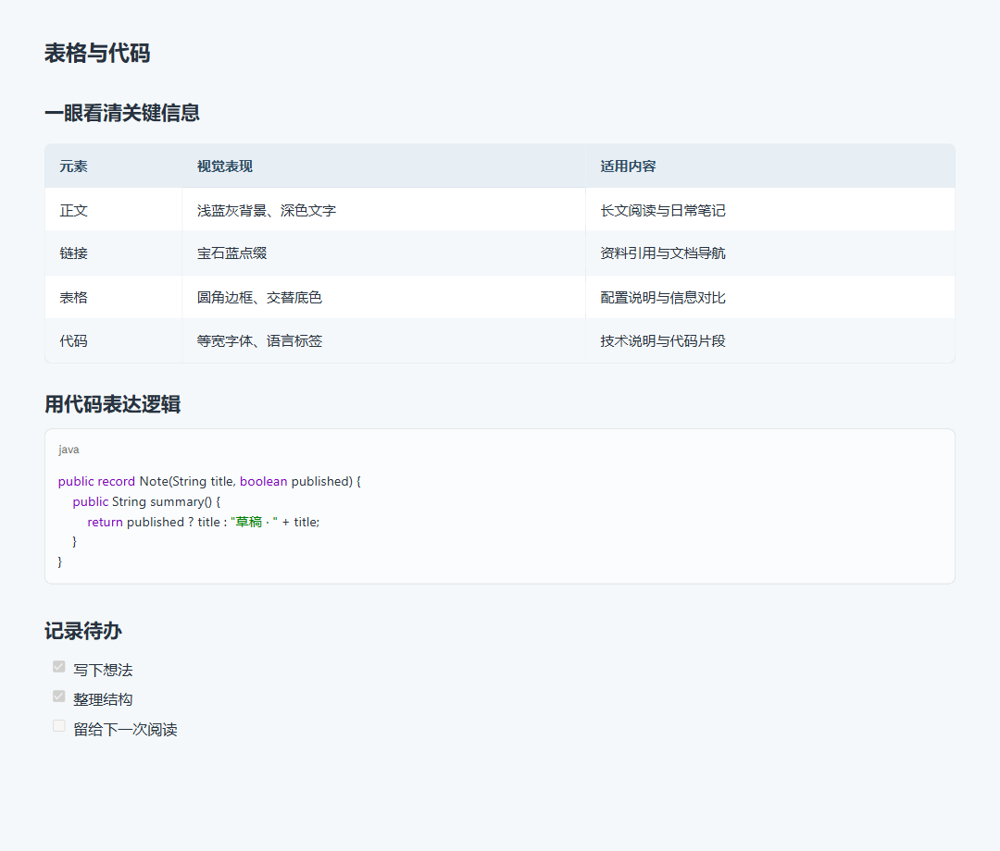

# Claude Sapphire

[English](README.md) | **简体中文**

一款以 Claude 主题为基础的 **Typora 浅色主题**。用浅蓝灰底色、宝石蓝点缀与清晰的文字层级，为笔记和技术文档提供安静的阅读体验。

## 主题预览

### 正文与排版



### 表格与代码



> 图片使用项目实际 CSS 与 Typora 基础样式在 Chromium 中渲染，不包含编辑器界面。不同系统的字体、Typora 版本和设置可能影响最终显示。示例内容见 [主题示例.md](examples/主题示例.md)，可直接用 Typora 打开预览。

## 特点

- **浅蓝灰配色**：统一正文、侧边栏和文件菜单的视觉基调，使用宝石蓝强调链接与导航。
- **清晰的正文排版**：默认正文 16px、1.5 倍行高，提供六级标题与中英文混排字体回退。
- **细致的表格样式**：圆角边框、交替行底色与悬停反馈，宽表格可横向滚动。
- **代码阅读**：等宽字体、代码块语言标签、语法配色与行内代码样式。
- **提示与图表**：为 NOTE、TIP、IMPORTANT、WARNING、CAUTION 提示块及 Mermaid 流程图提供样式。
- **独立主题文件**：基础样式已合并进 `claude-sapphire.css`，无需另外安装 Claude 主题。
- **打印适配**：提供表头重复、表格行分页控制等打印样式；实际分页取决于文档内容与导出设置。

## 安装

1. 在本仓库页面选择 **Code → Download ZIP**，下载并解压；也可以克隆仓库：

   ```bash
   git clone https://github.com/emptypty01/claude-sapphire.git
   ```

2. 打开 Typora 的 **偏好设置 → 外观 → 打开主题文件夹**。
3. 将 `claude-sapphire.css` 和整个 `claude_fonts` 文件夹一起复制到主题文件夹中，保持以下相对位置：

   ```text
   themes/
   ├── claude-sapphire.css
   └── claude_fonts/
       ├── AnthropicSansWebText.ttf
       ├── AnthropicSerifWebText.ttf
       ├── AnthropicMonoVariable.ttf
       └── NotoSerifSC-VariableFont_wght.ttf
   ```

4. 重启 Typora，在 **主题** 菜单中选择 **Claude Sapphire**（名称显示可能因版本略有差异）。
5. 打开 [examples/主题示例.md](examples/主题示例.md)，查看正文、表格、代码、提示块和 Mermaid 的显示效果。

更新时覆盖主题 CSS 和字体目录，再重新启动 Typora。如果修改过主题文件，请先保留自己的自定义内容。

安装步骤也可参考 [Typora 官方主题说明](https://support.typora.io/About-Themes/)。

## 字体说明

主题保留了基础 Claude 样式的字体声明，同时为正文与代码设置了以下优先顺序：

| 用途 | 当前字体顺序 |
| --- | --- |
| 正文与标题 | Bookerly → Inter → Segoe UI → 霞鹜文楷 GB → LXGW WenKai → Microsoft YaHei → sans-serif |
| 代码 | JetBrains Mono → Cascadia Code → Consolas → monospace |
| 基础界面 | Anthropic Sans Web Text → 系统无衬线字体 |

Bookerly、Inter、霞鹜文楷、JetBrains Mono 等可选字体未随仓库提供，按需自行安装即可。字体回退会针对字符分别发生，因此中英文可能使用不同字体。

`claude_fonts/` 中的字体用于基础字体声明；复制字体目录并不意味着正文默认使用这些字体。CSS 中另保留了 `UnifrakturMaguntia` 声明，但当前仓库未包含对应字体文件，引用该字体的内容会按字体栈回退。

## 自定义

按照 [Typora 自定义 CSS 说明](https://support.typora.io/Add-Custom-CSS/)，可在主题目录创建或编辑 `claude-sapphire.user.css`，保留个人设置，方便后续更新主题。下面的示例调整字体、蓝色强调色和阅读宽度：

```css
:root {
    --font-serif: "LXGW WenKai", "Microsoft YaHei", sans-serif;
    --font-mono: "JetBrains Mono", Consolas, monospace;
    --topaz-accent: #326a96;
}

@media screen {
    #write {
        max-width: 1080px;
    }
}
```

默认阅读区域最大宽度为 `1280px`，在窄窗口中会减少左右留白。`--topaz-accent` 控制引用该变量的强调色，部分组件使用独立配色。

## 常见问题

**主题没有出现在菜单中？**  
确认复制的是 `claude-sapphire.css` 本身，而不是外层仓库目录；文件应直接位于 Typora 主题目录中，然后重启 Typora。

**字体与预览图片不一致？**  
检查本机安装的字体及上面的回退顺序，并确认 `claude_fonts/` 与 CSS 同级。系统缩放、Typora 缩放也会影响观感。

**提示块或流程图没有渲染？**  
这些功能依赖 Typora 对相应 Markdown 扩展的支持；请检查版本和 Markdown 相关设置。主题仅提供样式，不包含 Markdown 或 Mermaid 渲染器。

**是否提供深色版本？**  
当前仅提供浅色主题。

## 来源与许可

主题 CSS 基于 Claude 主题整合。Claude 为 Anthropic 的产品名称，本项目为独立的 Typora 主题项目。

仓库的许可声明见 [LICENSE](LICENSE)。第三方字体及继承的主题资源仍须遵循各自原有许可；仓库许可不替代第三方资源的授权条款。

遇到显示问题，欢迎在 [Issues](https://github.com/emptypty01/claude-sapphire/issues) 中附上 Typora 版本、操作系统及可复现的 Markdown 片段。
